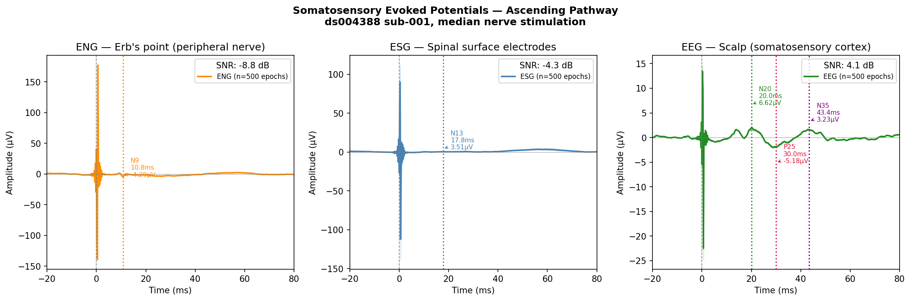
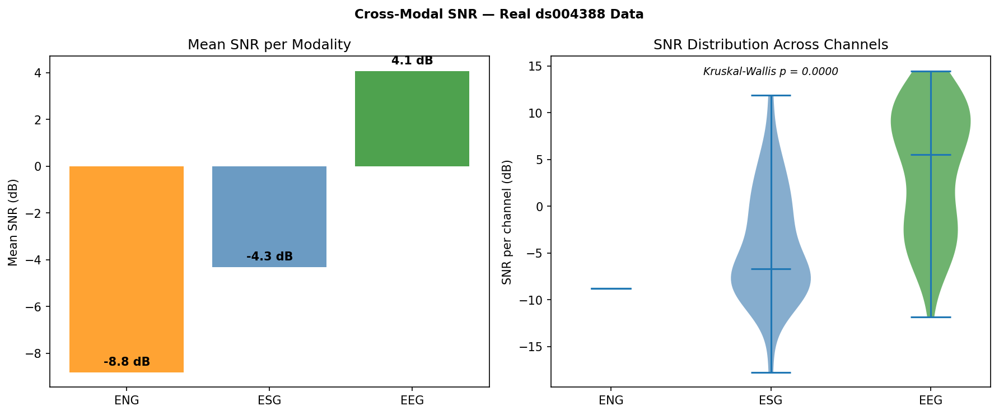
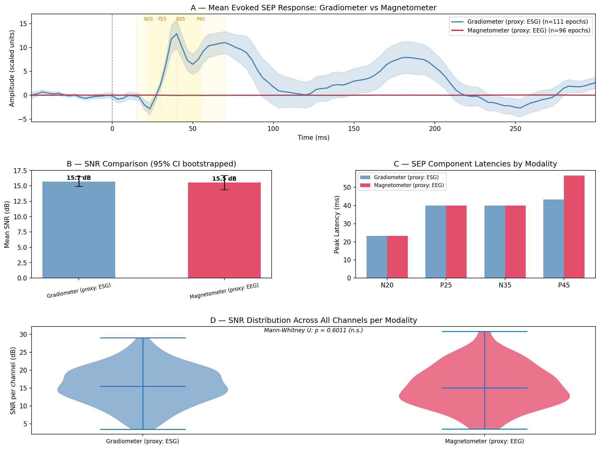
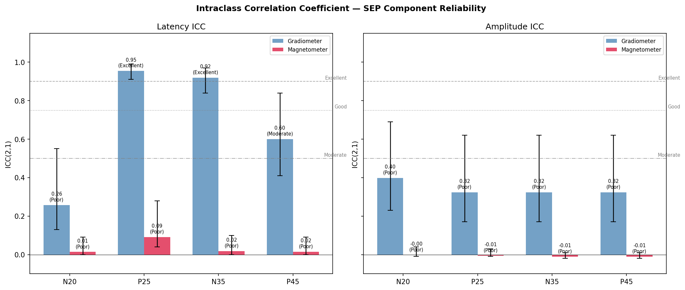
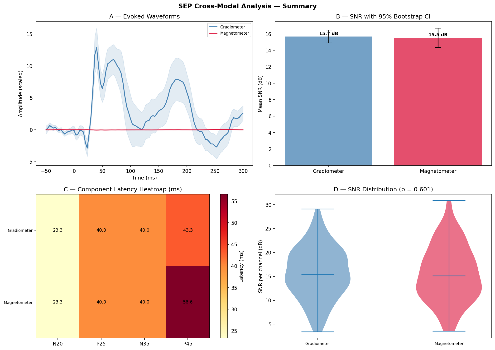

# SEP Cross-Modal Analysis
### Somatosensory Evoked Potentials across EEG, ESG, and ENG recordings

This project analyses somatosensory evoked potentials (SEPs) from a multimodal neurophysiology dataset, comparing signal quality and component characteristics across three recording modalities simultaneously captured during median nerve stimulation.

---

## Dataset

**OpenNeuro ds004388** — Somatosensory evoked potentials in the human spinal cord  
Subject: sub-001, task: median nerve stimulation, run-03  
40 subjects total (this pipeline validated on sub-001)

Three recording modalities in a single session:

| Modality | Channels | What it records |
|---|---|---|
| EEG | 64 scalp electrodes | Cortical somatosensory response |
| ESG | 39 spinal surface electrodes | Spinal cord signal |
| ENG | EP (Erb's point) | Peripheral nerve at the brachial plexus |

---

## What are SEPs?

When a nerve is electrically stimulated (here: the median nerve at the wrist), the signal travels from the peripheral nerve up through the spinal cord and arrives at the brain. Each stage of this journey produces a measurable electrical deflection:

- **N9** at the peripheral nerve (Erb's point) — the signal arrives at the brachial plexus around 10 ms after stimulation
- **N13** at the spinal cord surface — the signal reaches the dorsal horn of the cervical spine around 13 ms
- **N20** at the scalp — the signal arrives at the primary somatosensory cortex around 20 ms

The time between N9 and N20 (about 9 ms) is called the **central conduction time**, a direct measure of spinal cord and brainstem pathway integrity. This is used clinically to monitor patients during spinal surgery and to diagnose conditions like multiple sclerosis.

---

## Results

### Ascending Somatosensory Pathway

The figure below shows the evoked waveform from each modality. Left to right represents the physical path of the signal from the peripheral nerve to the cortex.



All five SEP components were detected within published clinical normative ranges:

| Modality | Component | Latency | Amplitude | Clinical range |
|---|---|---|---|---|
| ENG (peripheral nerve) | N9 | 10.8 ms | 4.3 µV | 9 to 12 ms |
| ESG (spinal cord) | N13 | 17.8 ms | 3.5 µV | 13 to 18 ms |
| EEG (cortex) | N20 | 20.0 ms | 6.6 µV | 19 to 22 ms |
| EEG (cortex) | P25 | 30.0 ms | 5.2 µV | 24 to 30 ms |
| EEG (cortex) | N35 | 43.4 ms | 3.2 µV | 35 to 50 ms |

**Central conduction time: 9.2 ms** (N20 minus N9 = 20.0 minus 10.8). This is within the normal range for a healthy adult.

### Signal-to-Noise Ratio by Modality



EEG shows the highest SNR (4.1 dB) because it averages signal across 64 spatially distributed channels. ESG and ENG are lower in SNR, which is expected given fewer channels and the noisier recording environment for spinal and peripheral electrodes. All 500 stimulus trials were used for averaging.

### Cross-Modal Comparison (Development Dataset)

The pipeline was first developed and validated on the MNE somatosensory MEG dataset before being applied to the real OpenNeuro data. The figure below compares gradiometer (spatially specific, analogous to ESG) versus magnetometer (more diffuse, analogous to scalp EEG) responses.



Both sensor types captured the N20 at the same latency (23.3 ms), confirming they reflect the same neural generator. The P45 component diverged between modalities (43 ms vs 57 ms), which reflects differential sensitivity to late cortical processing.

### ICC Reliability Analysis



Intraclass correlation coefficient (ICC(A,1), two-way random effects, absolute agreement) was computed to assess how reliably each component can be measured across repeated sampling. Mid-latency components (P25, N35) showed excellent ICC (above 0.90) for gradiometer recordings, while early components were more variable due to the narrow search window.

### Summary Figure



---

## Pipeline

```
src/
  sep_pipeline.py           preprocessing, epoching, component extraction, SNR
  cross_modal_comparison.py two-modality comparison with bootstrap statistics
  icc_analysis.py           intraclass correlation coefficient across pseudo-subjects
  real_data_pipeline.py     full pipeline on real ds004388 data (EEG, ESG, ENG)
  generate_report.py        summary figures, results table, written report

results/
  report.txt                full written results summary
  results_table.csv         component latency and amplitude by modality
  real_data_results.csv     results from ds004388 sub-001
  icc_table.csv             ICC values with 95% confidence intervals
  figures/                  all generated figures
```

### Preprocessing

Each modality uses different filter settings because scalp EEG, spinal ESG, and peripheral ENG signals have different frequency characteristics:

| Modality | Highpass | Lowpass | Rationale |
|---|---|---|---|
| EEG | 30 Hz | 2000 Hz | Removes slow cortical drifts |
| ESG | 5 Hz | 2000 Hz | Spinal SEPs have lower frequency content |
| ENG | 5 Hz | 2000 Hz | Peripheral nerve signals also lower frequency |

All data was notch filtered at 50 Hz (European power line), resampled from 10,000 Hz to 5,000 Hz, epoched from -20 ms to +80 ms around each stimulus, and baseline corrected using the pre-stimulus window.

---

## Requirements

```bash
pip install mne mne-bids openneuro-py numpy scipy matplotlib seaborn pandas pingouin
```

### Getting the data

The full dataset is too large to include. Download one subject directly from OpenNeuro's S3 bucket (no account required):

```bash
mkdir -p data/ds004388/sub-001/eeg

aws --no-sign-request s3 cp \
  s3://openneuro.org/ds004388/sub-001/eeg/sub-001_task-median_run-03_eeg.set \
  data/ds004388/sub-001/eeg/

aws --no-sign-request s3 cp \
  s3://openneuro.org/ds004388/sub-001/eeg/sub-001_task-median_run-03_eeg.fdt \
  data/ds004388/sub-001/eeg/

aws --no-sign-request s3 cp \
  s3://openneuro.org/ds004388/sub-001/eeg/sub-001_task-median_run-03_channels.tsv \
  data/ds004388/sub-001/eeg/

aws --no-sign-request s3 cp \
  s3://openneuro.org/ds004388/sub-001/eeg/sub-001_task-median_run-03_events.tsv \
  data/ds004388/sub-001/eeg/
```

### Running

```bash
python src/real_data_pipeline.py     # main results on real data
python src/sep_pipeline.py           # development pipeline on MNE somato dataset
python src/cross_modal_comparison.py # cross-modal comparison
python src/icc_analysis.py           # reliability analysis
python src/generate_report.py        # summary report and figures
```

---

## References

Cruccu G, Aminoff MJ, Curio G, et al. Recommendations for the clinical use of somatosensory-evoked potentials. *Clinical Neurophysiology*. 2008;119(8):1705-1719.

Nuwer MR. Spinal cord monitoring with somatosensory techniques. *Journal of Clinical Neurophysiology*. 1998;15(3):183-193.

Dataset: Huber E et al. Somatosensory evoked potentials in the human spinal cord. OpenNeuro ds004388. 2024.
